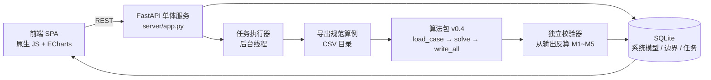

# 基于市场环境的电力系统规划仿真平台

把一套停留在 CSV 规范和求解脚本里的「源网荷储规划模型 v0.4」，做成可建模、可复现、可交付的规划仿真工具。

**模块一 · 电力系统规划**（已完成）｜**模块二 · 电力市场模拟**（预留）

---

## 它解决什么问题

课题或项目里，算法跑通不等于工具可用。真实工作流通常是：数据散落在若干 Excel 里、字段口径靠口头约定、换个人跑不出同样的结果、出了问题没人能独立复核。

这个平台把这条链路固化成一个可操作的闭环：

```
建模 → 运行边界 → 算法参数 → 执行计算 → 结果分析 → 对比分析
```

每一屏对应一个决策，参数有出处，结果有独立校验，算例与产物都落盘可追溯。

## 功能

| 环节 | 能力 |
|---|---|
| 系统建模 | 机组 / 节点 / 线路 / 联络线四类清单，逐条增删改；CSV 模板导出与导入（全量替换，编码自适应 utf-8 / GBK，报错定位到行号）；拓扑力导向图，待建机组单独标记 |
| 运行边界 | 全年 8760h 口径；负荷 / 新能源 / 区外来电三类边界，按清单自动生成填写表单；日 × 24 时段网格编辑；分月概览与逐时曲线 |
| 算法参数 | 投资上限、弃电惩罚、年化系数（CRF / 年限 / 折现率）、新能源占比下限、MIP Gap、求解时限；**计算周期**可选 24h / 168h / 720h / 全年，并实时预估求解规模 |
| 执行计算 | 后台任务 + 进度轮询，关闭页面不中断；任一阶段可取消；失败原因给出可操作提示 |
| 结果分析 | 目标值、投建容量、新能源占比、弃电率、供电成本五张 KPI；机组出力堆叠图；投建方案表；结果 CSV 与汇总导出 |
| 对比分析 | 多方案横向对比（指标表 + 柱状图），含规划前后（不投建 / 投建）口径 |

## 技术架构



选型原则是**部署成本最低**：无 Node 构建链、无外部数据库、无消息队列，一个进程 + 一个 SQLite 文件即可运行，也能直接装进客户内网。

## 三个关键设计决策

**1. 算法零侵入 —— 用数据契约做边界**

平台不 import 算法内部对象，只在任务提交时把数据库里的模型还原成一份符合《源网荷储规划算法数据规范》的 CSV 目录，再调用 `load_case → SGLSModel → write_all`。算法包一行未改。

好处是双向的：算法升级不用动平台；平台换存储也不影响算法。代价是每次求解都要落一份算例目录——但这恰好成了可追溯的审计物。

**2. 把"算不动"变成可预判的配置问题**

Gurobi 受限许可的上限是 2000 变量 / 约束，而全年 8760h 的模型是百万级变量，直接求解只会得到一句 `Model too large for size-limited license`。

平台的处理不是把错误翻译成中文了事，而是把规模显式化：按 `T × (机组×3 + 节点 + 线路 + 2)` 预估变量数，在参数页实时显示，超限飘红；同时提供 24h / 168h / 720h / 全年四档计算周期，导出算例时按时段裁剪。用户在点"执行"之前就知道能不能跑。

**3. 空状态就是真空的**

没有数据时不画图、不补样例、不摆"示例 KPI"。四类清单默认空，由用户自建；没有任务时结果页只给引导卡，而不是一张看起来很像成果的堆叠图。

这条看着像洁癖，实际是产品判断：一个会用假数据填满界面的工具，用户没法判断自己看到的到底是算出来的还是摆出来的。

## 结果可信度

求解完成后，独立校验器不依赖求解器内部状态，仅从输出 CSV 反算 M1~M5 约束是否满足，逐条给出 PASS / FAIL。前端把校验结论与失败明细直接展示在结果页——**算错了要看得出来**。

## 快速开始

```bash
# Windows：双击 start.bat（首次自动建虚拟环境、装依赖）
# Linux / macOS：
./start.sh          # 默认 8000 端口

# 或手动
pip install -r requirements.txt
python -m uvicorn server.app:app --host 0.0.0.0 --port 8000
```

打开 <http://localhost:8000>。首次是空库，请新建系统后录入清单，或导入 `data/sample` 下的样例。

> 求解功能需接入 `algorithm/` 的算法实现（接口契约见 [algorithm/README.md](algorithm/README.md)）；
> 建模、边界、参数、对比分析不依赖它，克隆即可使用。
> 求解器：`pip install gurobipy` 自带受限许可（≤2000 变量），可跑 24~720 时段算例；全年直解需完整许可（学术 WSL 许可免费申请）。

## 目录结构

```
server/            后端服务（app.py / db.py / jobs.py）+ 前端 static/
algorithm/         求解核心——接口契约见 algorithm/README.md（实现不随仓库公开）
data/sample/       合成样例算例（N1/N2 母线，非真实电网数据）
docs/              部署与交付手册、系统设计说明
pack.py            分发包打包脚本
start.bat|sh       一键启动
```

## 文档

- [部署与交付手册](docs/部署方案.md) —— 单机 / 局域网 / Docker / 离线安装 / 数据迁移 / Gurobi 许可 / 故障排查
- [系统设计说明](docs/系统设计说明.md) —— 数据模型、接口契约、算法对接与规模路线

## 数据与授权说明

- 仓库内的样例数据由 `make_sample_data.py` 生成，是合成数据，不含任何真实电网或市场数据。
- 运行期数据库（`platform.db`）与算例产物（`platform_data/`）已在 `.gitignore` 中排除。
- **平台层代码以 MIT 许可开源**（见 `LICENSE`）；
  `algorithm/` 下的求解实现与《源网荷储规划算法数据规范》为作者私有成果，
  **不随仓库分发、保留所有权利**。平台与算法通过五个函数的接口契约解耦，
  实现契约即可完整跑通，见 [algorithm/README.md](algorithm/README.md)。
- 因此：克隆本仓库后，建模 / 边界 / 参数 / 对比全流程可用，求解功能需接入算法实现。

---

如用于研究或教学，欢迎交流。问题与建议请提 Issue。
